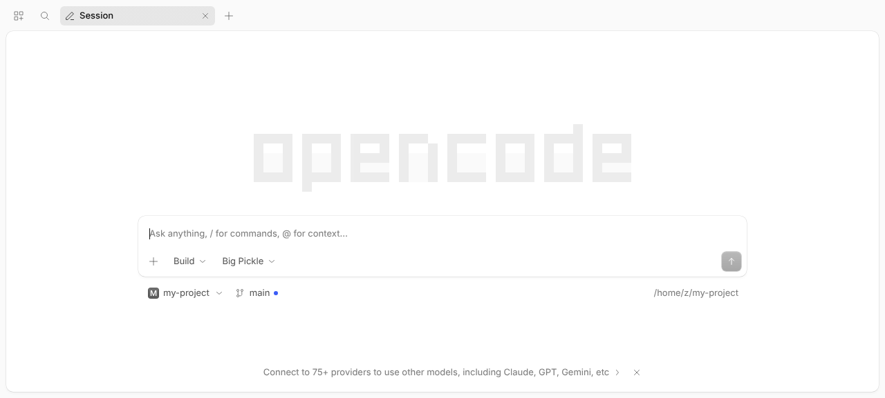

<h1 align="center">OpenCode Web</h1>

<p align="center">A <b>web version of the OpenCode desktop app</b>, built from this repository's own source.</p>

<p align="center">
  
  
</p>
<p align="center">
  
</p>

## What is this?

The desktop app is an Electron shell around a SolidJS renderer plus the `opencode`
engine. The renderer is platform-adaptive: without the Electron bridge it runs its
built-in **web platform** (`packages/app/src/runtime/platform/web.ts`) and talks to
the engine over same-origin HTTP.

This fork keeps all upstream code untouched and adds a small, dependency-free
Node.js shell (`server.js` at the repo root) that plays the role the Electron main
process plays on desktop:

```
Desktop app  =  Electron main process  +  SolidJS renderer  +  opencode engine
Web version  =  Node.js server.js      +  the same renderer  +  the same engine
```

It

- builds the official web UI from this repo (`bun install` + `vite build` in `packages/app`),
- spawns `opencode serve` (the v2 API + web engine) as a sidecar and reads the server password it prints,
- serves the UI at `/` and reverse-proxies `/api/*` — REST, SSE events, and WebSocket
  upgrades (PTY terminals) — to the engine, injecting its Basic auth **server-side**
  so the browser never sees a credential,
- reports readiness at `/__status`.

Everything you get — tabs, sessions, diffs, review, terminal panel, themes, PWA —
is the desktop app's own UI, unmodified.

## Fork touches

Two small, deliberate deltas from upstream, both in this repo:

- **A black `reset` button next to the model / effort selector** — olliecode's
  usage-reset pill, rebuilt for the web app. It sits in the composer controls
  row, so it appears on every tab (current ones and new ones). One click zeroes
  the engine's **local usage accounting**: the cost / token aggregate columns
  on every session (`session_v2.cost`, `tokens_input`, `tokens_output`,
  `tokens_reasoning`, `tokens_cache_read`, `tokens_cache_write`) plus the usage
  event rows in the engine's SQLite database. Conversations are never touched —
  sessions, messages and parts all stay. A timestamped `.backup` of the
  database is written to `usage-backups/` before each reset, so it is always
  reversible. Local-only by design: nothing outside this deployment's own
  database is touched — no IP rotation, no identity rewriting; provider-side
  quotas are theirs to enforce. Lives in
  `web-overlay/packages/app/src/composer/editor/editor.tsx` (the button) and
  `server.js` (`POST /__reset-usage`).

  <p align="center">
    
  </p>

- **A full Linux sandbox** — the container ships a real coding environment, not
  a bare image: `python3` (+ `pip`, `venv`), `git`, `gcc`/`g++`/`make`
  (build-essential), `ripgrep`, `jq`, `sqlite3`, `curl`/`wget`, `unzip`/`zip`,
  `openssh-client`, `nano`, man pages — on top of Node 24. The agent shells out
  inside `/workspace` and everything a project needs is already there; the
  welcome file in `/workspace` says so too.

## Run locally

```sh
node server.js                       # http://localhost:8080
```

Requires Node >= 18, a built UI (`bun install && bun run --cwd packages/app build`,
copy `packages/app/dist` next to `server.js` as `web/`) and the engine
(`./engine/opencode`, or any `opencode` on `PATH` via `ENGINE_BIN`).
Without a `web/` directory, `server.js` serves the engine's embedded web build instead.

## Deploy (Docker)

The root `Dockerfile` does everything — builds the UI from source, downloads the
engine from the official 2.4.2 package, and runs the server:

```sh
docker build -t opencode-web .
docker run -p 8080:8080 -v "$PWD/my-project:/workspace" opencode-web
```

The agent operates on `/workspace` (override with `OPENCODE_PROJECT_DIR`).

## Deploy to running.sh

The repo deploys as-is (the Dockerfile is detected and built as a container).
**Size: `standard-4`** — that is what this deployment runs (more storage, more
headroom, faster builds). It also needs more than `lite` would give: the
lite instance's 256 MiB cannot hold the Node proxy plus the Bun-compiled engine
at the same time; no matter the memory caps, a lite container serves fine for
about a minute and a half and then gets OOM-killed (SIGKILL 137) in a loop.

```sh
# project + service (public repo, no GitHub App needed)
curl -X POST -H "Authorization: Bearer $RUNNING_TOKEN" https://running.sh/api/v1/projects \
  -d '{"workspaceId":"'$WS'","name":"opencode-web"}'
curl -X POST -H "Authorization: Bearer $RUNNING_TOKEN" \
  https://running.sh/api/v1/projects/$P/services \
  -d '{"name":"web","source":{"type":"github","repo":"OWNER/opencode","branch":"dev"}}'
```

### Keeping state across deploys

The deployment mounts a persistent disk volume at `/data` (the engine's XDG
home), so sessions, auth logins and config survive deploys on their own —
no ritual needed. Two belt-and-braces endpoints remain in `server.js`,
gated by a `PERSIST_TOKEN` secret (set it as an encrypted service variable):

- `GET /__persist/dump` — stops the engine for a consistent snapshot, tars
  `/data/xdg`, restarts the engine, streams the archive;
- `POST /__persist/restore` — extracts an uploaded archive and restarts the
  engine so the database reloads.

`scripts/persist-snapshot.sh save | restore | deploy` wraps them
(save → deploy via the API → restore → verify). Verified end to end: a session
created before a deploy is still there after it.

Configuration (environment variables for `server.js`):

| Variable               | Default             | Meaning                                     |
| ---------------------- | ------------------- | ------------------------------------------- |
| `PORT` / `HOST`        | `8080` / `0.0.0.0`  | Where the web app listens                   |
| `ENGINE_BIN`           | `./engine/opencode` | Engine binary (falls back to `opencode` on PATH) |
| `ENGINE_PORT`          | random free port    | Fixed engine port                           |
| `OPENCODE_PROJECT_DIR` | current directory   | The project the agent works on              |
| `WEB_DIR`              | `./web`             | Built renderer directory                    |

## Using the app

1. Open the app — Home shows projects and recent sessions, like the desktop app.
2. **New session** — the composer supports `/` commands, `@` context mentions,
   image attachments and agent selection (Build / Plan / Big Pickle).
3. The engine is the real OpenCode v2 engine: sign in to a provider
   (`engine/opencode auth login` or an `opencode.json` in the project directory)
   and sessions run models. Without a provider the UI works end to end, but the
   agent has nothing to call.

## Credits & license

All upstream code is [OpenCode](https://github.com/anomalyco/opencode) by
[Anomaly](https://anomaly.co) — MIT licensed. The additions in this fork
(`server.js`, `Dockerfile`, docs) are MIT as well.
